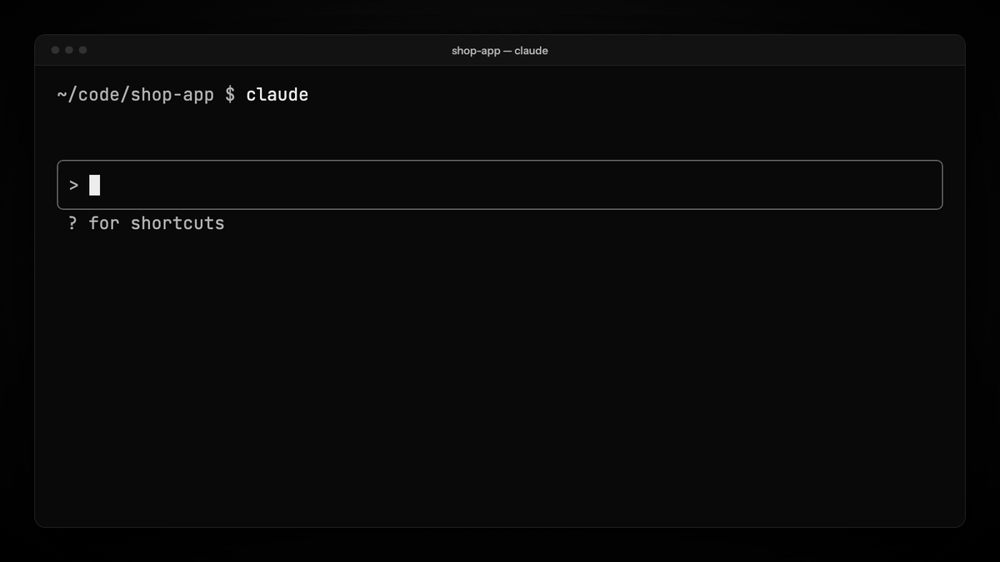

<p align="center">
  <picture>
    <source media="(prefers-color-scheme: dark)" srcset="assets/wordmark-dark.svg">
    
  </picture>
</p>

<p align="center"><b>Press Ctrl+G and the rambling prompt you just dictated becomes the one you meant to type — in place, inside Claude Code, on the plan you already have.</b></p>

<p align="center">
  <a href="https://yadava5.github.io/unramble/"><b>Install in one click</b></a> ·
  <a href="#what-it-does">What it does</a> ·
  <a href="#runs-on-your-plan">Runs on your plan</a> ·
  <a href="docs/BENCHMARKS.md">Benchmarks</a> ·
  <a href="docs/HOW-IT-WORKS.md">How it works</a>
</p>

<p align="center">
  <a href="https://github.com/yadava5/unramble/actions/workflows/ci.yml"></a>
  <a href="https://www.npmjs.com/package/unramble"></a>
  <a href="LICENSE"></a>
  
  
</p>

<p align="center">
  
</p>

You talk faster than you type, so you dictate. Then Claude Code gets *"uh no wait, not the
handler, the session middleware"* and takes every word literally. unramble rewrites the draft
before you send it: fillers and false starts gone, the correction applied, separate asks
numbered, standing rules under *Constraints*. Same meaning — nothing added, nothing you said
lost. Ctrl+G again puts your original back.

## Install

**One click:** [**Install in Claude Code →**](https://yadava5.github.io/unramble/) opens Claude
Code in your terminal with the install command typed in; press Enter.

**In your terminal** (zsh, bash, PowerShell — not inside Claude Code; needs Node 18+):

```sh
npx unramble
```

That installs the plugin and binds Ctrl+G in one step.

**Or inside Claude Code**, with no Node needed: start `claude`, then type these at its `❯`
prompt, one at a time. Claude Code has no shorter form for a plugin outside its own directory.

```text
/plugin install unramble --marketplace yadava5/unramble
/unramble setup
```

Answer `y` to add the marketplace and pick a scope (user is the default). `setup` binds Ctrl+G;
it keeps a backup of your `keybindings.json` and never overwrites a key you bound yourself.

Then quit Claude Code and start a new session (`claude`), say or type a prompt, and press
**Ctrl+G**. Works with Claude Code 2.1.308 and every release after it: CI tests the newest
Claude Code every day on Linux, macOS and Windows. It always uses the newest Sonnet or Opus,
because it asks for the model by family, never by version. See
[Where it is tested](#where-it-is-tested).

## What it does

The demo above is a real rewrite (Sonnet on a Claude Code plan, 3.3 s). What was said:

> okay so um the login page is broken again I think, like when you hit submit it just spins
> forever. can you look at the auth handler, uh no wait, not the handler, the session
> middleware, that's what changed yesterday. and then once it works add a test for it so this
> doesn't happen again. oh and don't touch the database migrations, we're kind of mid deploy

What Claude Code gets:

```text
The login page is broken again, I think: when you hit submit, it spins forever.

1. Look at the session middleware, which is what changed yesterday.
2. Once it works, add a test for it so this doesn't happen again.

Constraints:
- Don't touch the database migrations; we're mid deploy.
```

(It is not perfect: "kind of" mid deploy lost its hedge. The [benchmarks](docs/BENCHMARKS.md)
count that as a minor defect.)

| Key | Does |
|---|---|
| **Ctrl+G** | rewrite the draft (the band above the box says `refining…`) |
| **Ctrl+G** on the rewrite | put your original back, exactly |
| **Ctrl+G** while it runs | cancel; your draft stays |

### What it will not do

- **Send anything you did not ask it to.** Nothing leaves the box until you press Ctrl+G.
- **Lose a machine value.** A rewrite that drops a path, `--flag`, number, URL, `@ref` or
  `[Pasted text]` chip is refused and your draft stays — unless you corrected that value on
  the spot ("src/utils, no wait, src/lib").
- **Add a link or a command you never said.** Pasted text can carry instructions; a rewrite
  that brings in a URL, `curl`/`wget`/`sudo`/`rm -…`, shell chaining or invisible characters
  you did not say is refused. On 2,240 recorded rewrites this refused none.
- **Touch pasted logs or code.** They are masked before the model sees the draft and put back
  byte for byte.
- **Answer your question or do the task.** "Can you check X?" stays a question for Claude Code.
- **Overwrite you.** If you typed while it ran, your text wins.

## Runs on your plan

unramble calls the model through your Claude Code session's own login (`$.model.complete`),
billed to your Claude Code subscription like any prompt. There is no API key, no network code
and no server anywhere in the plugin. Each rewrite is one short call: ~3k tokens of rules
(cached after the first rewrite) plus your words.

## What it does on your machine

Everything the plugin's hooks module ([`plugin/hooks/register.tsx`](plugin/hooks/register.tsx))
can reach. The plugin is the [`plugin/`](plugin/) folder, the only part of this repository
that Claude Code installs:

- **Sends**: on Ctrl+G only, your draft, with pasted logs and code masked out, plus the rules
  in [`prompt/system.md`](plugin/prompt/system.md), to the model through Claude Code's own
  session (`$.model.complete`), on your Claude Code plan. The plugin has no network code, no
  API key and no server of its own; nothing else leaves your machine.
- **Writes**
  - `keybindings.json` in your Claude Code config folder (`$CLAUDE_CONFIG_DIR`, else
    `~/.claude`), only when you run `/unramble setup`: it adds the two Ctrl+G bindings and
    keeps your original file beside it as `keybindings.json.unramble-backup`. It is a settings
    file, and that is the only file the plugin writes.
  - Your prompt box, only when you press Ctrl+G: the rewrite, or your original back.
- **Reads**: its own `prompt/system.md`; `keybindings.json` (to know whether Ctrl+G is bound);
  the environment variables `CLAUDE_CONFIG_DIR`, `HOME` and `USERPROFILE` to find that folder.
  As you edit, it sees the prompt box's text only to count words for the band and to remember
  what a paste chip stands for, and forgets both when you send. It never reads your
  conversation, history or project files.
- **Hooks**
  - `session.start`: registers `/unramble` and checks whether Ctrl+G is bound; if not, shows
    one toast saying to run `/unramble setup`.
  - `command.run` (`/unramble` only): runs `setup` or `status`. It sees no other command.
  - `prompt.edit`: notes whether the box holds a draft and what a paste chip stands for, so the
    band and the rewrite see your words. It changes nothing. A prompt recalled from history, or
    a box you cleared, reaches the band at your next key.
  - `prompt.submit`: forgets the draft once you send it. It never changes or blocks a prompt.
  - `ui.render` (above the prompt): draws the `⌃G refine` band.
- **Runs**: no commands and no processes. Adds one slash command, `/unramble`.
- **Refuses**: a rewrite that adds a link, a shell command or shell chaining you never said.
  Text pasted into the box can carry instructions, and the prompt goes to an agent that can
  run commands. On 2,240 recorded rewrites this refused none.

## Settings

`/config` (the unramble rows), or `claude plugin configure unramble`:

| Setting | Default | |
|---|---|---|
| Model | `sonnet` | `sonnet` (fast, light on your plan) or `opus` (the most faithful) |
| Names you often say | empty | comma-separated names of your tools, agents and projects, so a dictation slip is spelled right |

`/unramble status` shows what is live.

## How good is it

Measured on 39 of the hardest real dictated prompts, two runs each, with Claude Opus judging
every rewrite against a fixed rubric ([method and full tables](docs/BENCHMARKS.md)):

| Model | Rewrites with no meaning change | Median time |
|---|---|---|
| Sonnet (default) | 76/78 | 3.0 s |
| Opus | 78/78 | 3.2 s |

That set is every case that ever failed during tuning, so it is harder than everyday speech.
It is also one person's speech, in English, about software; the [eval kit](eval/README.md)
runs the same check on yours. Haiku was tried and dropped (9 major errors in 17 prompts).

## Where it is tested

Ctrl+G reaches the plugin as whatever bytes the terminal sends for it, and terminals send it
two ways, so both were tried with a real keypress:

| Where | Ctrl+G arrives as | Result |
|---|---|---|
| kitty, macOS | kitty keyboard protocol | rewrite, restore, cancel, `/unramble status` ✓ |
| Terminal.app, macOS | legacy `0x07` | rewrite and restore ✓ |
| Ghostty 1.3, macOS | not measured | rewrite and restore ✓ |
| VS Code terminal, macOS | not measured | rewrite and restore ✓ (Ctrl+G reaches Claude Code, not VS Code's *Go to Line*) |
| Cursor terminal, macOS | not measured | rewrite and restore ✓ |
| Linux (Debian, tmux) | legacy `0x07` | key reaches the plugin and the model call goes out ✓ |
| Windows, Linux, macOS (CI) | — | install, Ctrl+G binding, uninstall and all tests, every push |

Not yet tried by hand: iTerm2, Windows Terminal, and Kiro's terminal (Kiro is built on the same
editor as VS Code and Cursor). If one does not work, please
[open an issue](https://github.com/yadava5/unramble/issues/new/choose).

## Limits

- **Terminal UI only.** The Ctrl+G chord reaches plugins in Claude Code's terminal interface
  (`claude` run in a terminal, including the one inside VS Code or Cursor). The VS Code
  extension's own chat panel and the desktop app are not supported.
- **A short window can hide the band.** In an 80×24 window with a tall status line, Claude Code
  may not draw the `⌃G refine` row; Ctrl+G still works.
- **Long pastes stay as chips.** When a dictation app pastes a long block, Claude Code folds it
  into a `[Pasted text #N]` chip that plugins cannot read (as of 2.1.308), so that text is kept as
  is. Claude Code's built-in voice input, macOS Dictation and typing all work fully.
- **Garbled speech stays garbled.** If the transcription is wrong in a way context cannot fix
  ("Apple ID" for a project name), the rewrite keeps it as heard rather than guess. Add the
  name to *Names you often say*.
- **The plugin API is early access.** CI runs the newest Claude Code every day to catch a
  release that moves it.

## Update

```sh
npx unramble update
```

Or have Claude Code keep it current: in `/plugin`, open the `unramble` marketplace and turn on
auto-update. That follows `main`, which outside changes reach only through a pull request the
maintainer approves, and where every push runs the full public CI.

## Uninstall

```sh
npx unramble uninstall
```

That removes the plugin and takes back only the two `ctrl+g` bindings setup added. Without
Node: `claude plugin uninstall unramble@unramble`, then delete those two lines from
`keybindings.json` yourself.

## Where it came from

I dictate long prompts into Claude Code and wanted them organised before the model reads
them. It started as a personal `$VISUAL` script on 2026-10-17 and went through eight rule
versions in two days, each measured before it shipped; the history is in the git log and
[docs/BENCHMARKS.md](docs/BENCHMARKS.md). This public version is a rebuild that runs on your
plan instead of an API key. I used Claude Code to build it.

## Contributing

Reports of a rewrite that changed your meaning are the most useful thing you can send; there
is an [issue template](https://github.com/yadava5/unramble/issues/new/choose) for it. Pull
requests are welcome: see [CONTRIBUTING.md](CONTRIBUTING.md).

## Security

Outside changes reach `main` only through a pull request the maintainer approves, every push
runs the full public CI, releases publish only from a maintainer-approved tag with npm
provenance, and CI fails any change that widens what the shipped code can reach. [SECURITY.md](SECURITY.md) lists exactly what the plugin touches and how
to report a vulnerability privately.

## License

[MIT](LICENSE) © 2026 Ayush Yadav
